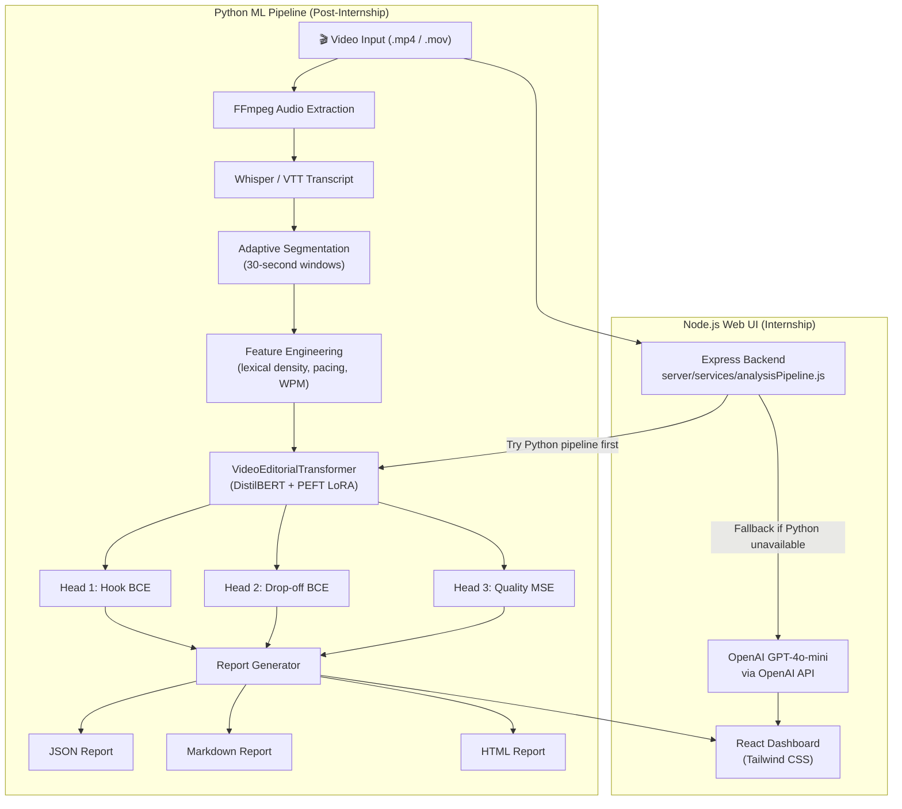
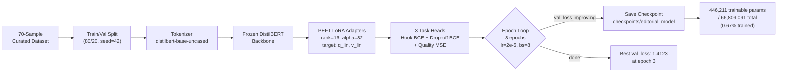
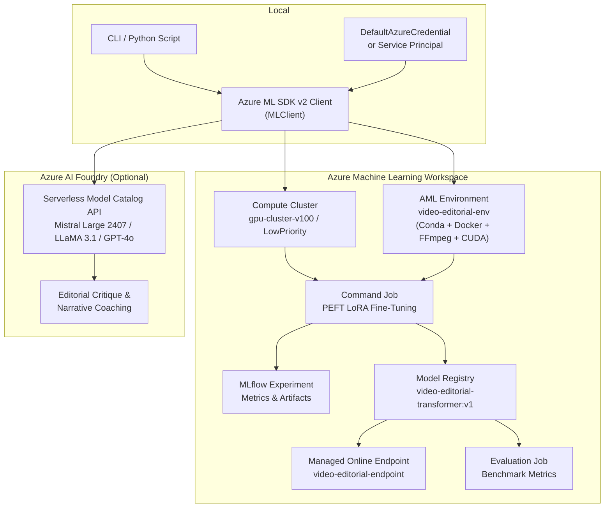

# Video Editorial Intelligence

<p align="center">
  
  
  
  
  
  
  
  
</p>

> An AI system for editorial analysis of video content — built as part of the **Microsoft Türkiye AI Innovators Internship Program 2026**, with a post-internship Python ML pipeline added featuring PEFT LoRA fine-tuning, Azure ML/Foundry integration, and a comprehensive evaluation suite.

---

## Table of Contents

1. [Architecture](#architecture)
2. [Fine-Tuning Workflow](#fine-tuning-workflow)
3. [Azure ML Workflow](#azure-ml-workflow)
4. [Evaluation Results](#evaluation-results)
5. [Quick Start](#quick-start)
6. [CLI Commands](#cli-commands)
7. [Streamlit Demo](#streamlit-demo)
8. [Azure ML Commands](#azure-ml-commands)
9. [Project Structure](#project-structure)
10. [Limitations](#limitations)
11. [Roadmap](#roadmap)
12. [Development History](#development-history)
13. [Contributing](#contributing)
14. [License](#license)

---

## Architecture

The system has two parallel paths: a **Node.js/React web UI** (built during the internship) and a **Python ML pipeline** (added post-internship). Both converge on the same editorial insights.



### Key Components

| Component | File | Role |
|---|---|---|
| `VideoEditorialTransformer` | `src/models/transformer.py` | DistilBERT backbone + 3 prediction heads |
| Training loop | `src/train.py` | PEFT LoRA fine-tuning with early stopping |
| Evaluation suite | `src/evaluate.py` | ROC-AUC, Brier, RMSE, Pearson r |
| Video pipeline | `src/pipeline/video_pipeline.py` | FFmpeg → transcript → segmentation |
| CLI entrypoint | `src/cli.py` | `analyze`, `train`, `evaluate`, `demo` |
| Streamlit app | `demo/app.py` | Interactive dashboard |
| Node.js backend | `server/services/analysisPipeline.js` | GPT-4o-mini + Python fallback |
| Azure ML submit | `azure/ml/submit_training.py` | SDK v2 cloud job submission |
| Azure Foundry | `azure/foundry/inference.py` | Serverless frontier model inference |

---

## Fine-Tuning Workflow



**LoRA configuration:**

| Param | Value |
|---|---|
| Rank (r) | 16 |
| Alpha | 32 |
| Dropout | 0.05 |
| Target modules | `q_lin`, `v_lin` (DistilBERT-specific) |
| Trainable params | 446,211 / 66,809,091 (0.67%) |
| Epochs | 5 (`--epochs 5`) |
| Learning rate | 2e-5 |
| Batch size | 8 |
| Best val_loss | 1.4123 |

---

## Azure ML Workflow



> [!NOTE]
> All Azure scripts run in **dry-run mode by default** — no cloud resources are created or charges incurred unless `--submit` / `--deploy` / `--register` flags are explicitly passed.

---

## Evaluation Results

> [!IMPORTANT]
> These numbers come from the bundled **synthetic** dataset (`generate_curated_editorial_dataset`): 70 samples generated from **10 hand-written sentence templates** with jittered acoustic features and labels. They are a pipeline sanity check, **not** evidence of real-world editorial or retention performance.

### Split (group-aware, stratified by label type)

Samples generated from the same template are near-duplicates, so whole templates are assigned to one split (`src/train.py::split_dataset`, checked by `assert_no_leakage`). An earlier version split by sample, which put copies of the same sentence in train and test and produced ROC-AUC = 1.0 — those numbers were leakage and have been removed.

| Split | Samples | Templates |
|---|---|---|
| Train | 42 | 6 |
| Validation | 7 | 1 |
| Test | 21 | 3 (one hook, one filler/drop-off, one neutral) |

### Metrics on the held-out templates

Command: `python -m src.train --epochs 5` then `python -m src.evaluate --checkpoint-dir checkpoints/editorial_model` (CPU, seed 42, best val loss 1.1412).

| Task / Metric | Baseline (random heads) | Fine-tuned (LoRA) |
|:---|:---:|:---:|
| Hook F1 (threshold 0.5) | 0.0000 | 0.0000 |
| Hook ROC-AUC | 1.0000 | 1.0000 |
| Drop-off ROC-AUC | 0.0000 | 1.0000 |
| Drop-off PR-AUC | 0.2124 | 1.0000 |
| Drop-off Brier (lower is better) | 0.2666 | 0.1432 |
| Quality RMSE (lower is better) | 2.4428 | 1.7399 |
| Quality Pearson r | -0.1506 | 0.9268 |
| CPU latency / segment | – | 17.34 ms (57.7 segments/s) |

**How to read this honestly**

- The test set contains only **3 distinct sentences** (7 jittered copies each). Ranking metrics over 3 sentences are close to meaningless: the random-init baseline also gets Hook ROC-AUC 1.0, and Drop-off ROC-AUC flips between 0 and 1 depending on how one sentence is ranked.
- **Hook F1 is 0** for both models: no hook probability crosses 0.5, so the hook head is uncalibrated. Thresholds were not tuned.
- Brier, RMSE and Pearson r do improve after fine-tuning, which shows the training loop learns *something* transferable across templates, but with 6 training templates this cannot be generalised.
- Largest residual: the fine-tuned model predicts quality ≈5.7 for the filler-heavy "And yeah, like I said before…" template whose label is ≈2.9.

The JSON / Markdown outputs are written to `outputs/evaluation/` (git-ignored; re-run the commands above to reproduce). Exact numbers may vary slightly across PyTorch versions/hardware.

Full methodology: [docs/EVALUATION.md](docs/EVALUATION.md).

### Model Details

| Detail | Value |
|---|---|
| Backbone | `distilbert-base-uncased` |
| Fine-tuning method | PEFT LoRA |
| Epochs | 5 (`--epochs 5`) |
| Training dataset | 42 synthetic samples (6 templates) after group split |
| Trainable parameters | 446,211 / 66,809,091 (0.67%) |
| Best validation loss | 1.1412 |

---

## Quick Start

### Prerequisites

- Python 3.12
- FFmpeg (for audio extraction from video files)

```bash
# macOS
brew install ffmpeg

# Ubuntu / Debian
sudo apt-get install -y ffmpeg

# Windows (Chocolatey)
choco install ffmpeg
```

### Installation

```bash
# 1. Clone the repository
git clone https://github.com/Nabilhassan12345/video-editorial-intelligence.git
cd "video-editorial-intelligence"

# 2. Create a Python 3.12 virtual environment
python3.12 -m venv .venv
source .venv/bin/activate        # Windows: .venv\Scripts\activate

# 3. Install Python dependencies
.venv/bin/python -m pip install --upgrade pip
.venv/bin/python -m pip install -e ".[dev]"

# 4. (Optional) Install Node.js dependencies for the web UI
npm install
```

### Verify Installation

```bash
# Confirm Python pipeline is importable
.venv/bin/python -c "from src.models.transformer import VideoEditorialTransformer; print('OK')"

# Confirm CLI works
.venv/bin/python -m src.cli --help

# Run the 26-test suite
.venv/bin/python -m pytest tests/ -q
```

---

## CLI Commands

The CLI is invoked via `python -m src.cli` (or `video-editorial` after `pip install -e .`).

### `analyze` — Analyze a Video or Transcript

```bash
# Analyze a video file end-to-end (FFmpeg extraction + ML inference)
.venv/bin/python -m src.cli analyze \
  --video examples/sample_video.mp4 \
  --transcript examples/sample_transcript.json \
  --output-dir outputs/reports

# Analyze a raw transcript string directly
.venv/bin/python -m src.cli analyze \
  --transcript "[00:00] In the next 60 seconds I will show you the exact strategy top creators use. [00:15] Let me pause here and find my notes... uh, wait a second." \
  --output-dir outputs/reports
```

### `train` — Fine-Tune the Model

```bash
# Dry-run: verify dataset loading and training loop without GPU
.venv/bin/python -m src.train --dry-run

# Full 3-epoch fine-tuning run
.venv/bin/python -m src.train \
  --epochs 3 \
  --batch-size 8 \
  --output-dir checkpoints/editorial_model
```

### `evaluate` — Benchmark Against Baseline

```bash
# Evaluate fine-tuned checkpoint vs zero-shot baseline
.venv/bin/python -m src.evaluate \
  --checkpoint-dir checkpoints/editorial_model

# Results written to:
#   outputs/evaluation/evaluation_summary.md
#   outputs/evaluation/evaluation_results.json
```

### `demo` — Launch Streamlit Dashboard

```bash
streamlit run demo/app.py
```

---

## Streamlit Demo

```bash
streamlit run demo/app.py
```

Open **[http://localhost:8501](http://localhost:8501)** in your browser.

**Demo features:**

- 🎬 Video upload and real-time preview
- 📝 Spoken transcript inspection (auto-extracted via FFmpeg)
- 📈 Modelled audience retention progression graph
- 🎯 Strategic editorial recommendations per segment
- 🚨 Retention drop-off alert cards with grounded evidence
- 📥 One-click JSON, Markdown, and HTML report downloads

**Sample video for testing:**

```bash
# Use the included sample video
.venv/bin/python -m src.cli analyze --video examples/sample_video.mp4
```

---

## Azure ML Commands

> [!IMPORTANT]
> All commands below run in **dry-run mode by default** and preview the job specification locally. Live submission to Azure requires valid Azure credentials (`az login` or `AZURE_SUBSCRIPTION_ID`, `AZURE_RESOURCE_GROUP`, `AZURE_WORKSPACE_NAME` environment variables).

### Setup Azure Credentials

```bash
# Option A: Azure CLI
az login
export AZURE_SUBSCRIPTION_ID="<your-subscription-id>"
export AZURE_RESOURCE_GROUP="<your-resource-group>"
export AZURE_WORKSPACE_NAME="<your-aml-workspace>"

# Option B: config file
cp azure/ml/config.json.example azure/ml/config.json
# Edit azure/ml/config.json with your workspace details
```

### Submit Training Job

```bash
# Preview job spec (dry-run, no charges)
.venv/bin/python -m azure.ml.submit_training

# Submit live to Azure ML compute cluster (requires credentials)
.venv/bin/python -m azure.ml.submit_training --submit --compute gpu-cluster-v100 --epochs 3
```

### Submit Evaluation Job

```bash
# Preview (dry-run)
.venv/bin/python -m azure.ml.submit_evaluation

# Submit live
.venv/bin/python -m azure.ml.submit_evaluation --submit --checkpoint-asset azureml:video-editorial-transformer:1
```

### Register Model Asset

```bash
# Preview registration payload (dry-run)
.venv/bin/python -m azure.ml.register_model --checkpoint-dir checkpoints/editorial_model

# Register into Azure ML Model Registry
.venv/bin/python -m azure.ml.register_model --checkpoint-dir checkpoints/editorial_model --register
```

### Deploy Managed Online Endpoint

```bash
# Preview deployment config (dry-run)
.venv/bin/python -m azure.ml.deploy_model --endpoint video-editorial-endpoint

# Deploy live
.venv/bin/python -m azure.ml.deploy_model --endpoint video-editorial-endpoint --deploy
```

### Azure AI Foundry (Serverless Inference)

```bash
# Run editorial analysis via Foundry model catalog
.venv/bin/python -m azure.foundry.inference --transcript examples/sample_transcript.json

# Specify a frontier model
.venv/bin/python -m azure.foundry.inference --model mistral-large-2407

# Benchmark multiple models
.venv/bin/python -m azure.foundry.evaluation --models mistral-large-2407 Meta-Llama-3.1-70B-Instruct
```

> [!NOTE]
> If Azure credentials are not configured, the Foundry client automatically falls back to **offline simulation mode**, allowing all tests and local steps to run at zero cost.

---

## Project Structure

```text
video intelligence/
├── README.md                        # This file
├── pyproject.toml                   # Project metadata & dependencies
├── requirements.txt                 # Pinned dependency list
├── .github/
│   └── workflows/
│       └── ci.yml                   # CI workflow (26-test suite)
│
├── src/                             # Python ML pipeline (post-internship)
│   ├── cli.py                       # CLI entrypoint: analyze/train/evaluate/demo
│   ├── train.py                     # PEFT LoRA fine-tuning loop
│   ├── evaluate.py                  # Benchmark evaluation suite
│   ├── models/
│   │   ├── transformer.py           # VideoEditorialTransformer
│   │   └── config.py                # Model hyperparameters
│   ├── pipeline/
│   │   └── video_pipeline.py        # FFmpeg → transcript → segmentation
│   ├── data/
│   │   └── dataset.py               # Dataset loading & splitting
│   └── utils/
│       └── report_generator.py      # JSON / MD / HTML report output
│
├── demo/
│   └── app.py                       # Streamlit interactive dashboard
│
├── tests/                           # 26-test pytest suite
│   ├── conftest.py                  # sys.path fixture
│   ├── test_model.py
│   ├── test_pipeline.py
│   └── test_evaluate.py
│
├── examples/
│   ├── sample_video.mp4             # Test video
│   ├── sample_transcript.json       # Test transcript
│   └── DEMO_GUIDE.md                # Step-by-step demo walkthrough
│
├── checkpoints/
│   └── editorial_model/             # Fine-tuned model checkpoint (gitignored)
│
├── outputs/
│   ├── evaluation/
│   │   ├── evaluation_summary.md    # Benchmark results (Markdown)
│   │   └── evaluation_results.json  # Benchmark results (JSON)
│   └── reports/                     # Per-video analysis outputs
│
├── azure/
│   ├── ml/                          # Azure ML SDK v2 integration
│   │   ├── README.md
│   │   ├── config.json.example
│   │   ├── environments/            # Conda env + Dockerfile
│   │   ├── jobs/                    # training_job.yaml, evaluation_job.yaml
│   │   ├── components/
│   │   ├── submit_training.py
│   │   ├── submit_evaluation.py
│   │   ├── register_model.py
│   │   └── deploy_model.py
│   └── foundry/                     # Azure AI Foundry integration
│       ├── README.md
│       ├── configs/
│       ├── prompts/
│       ├── client.py
│       ├── inference.py
│       └── evaluation.py
│
├── docs/                            # Extended documentation
│   ├── ARCHITECTURE.md
│   ├── FINE_TUNING.md
│   ├── EVALUATION.md
│   ├── AZURE_MACHINE_LEARNING.md
│   └── REPRODUCIBILITY.md
│
└── server/                          # Node.js Express backend (internship)
    ├── services/
    │   ├── analysisPipeline.js      # GPT-4o-mini + Python fallback
    │   └── pythonRunner.js          # Calls Python CLI via execFile
    └── routes/
        └── analysis.js
```

---

## Limitations

> [!CAUTION]
> Please read these limitations carefully before drawing conclusions from the evaluation results.

1. **Small training dataset (70 samples):** The model was fine-tuned on a 70-sample curated synthetic dataset. This is orders of magnitude smaller than what production editorial AI systems require. Performance may not generalise to real-world video content.

2. **Synthetic/curated benchmark:** Evaluation labels (hook, drop-off, quality) were synthetically generated or manually curated, not derived from real viewer retention telemetry (e.g., YouTube Analytics). The benchmark measures fit to the curated dataset, not real-world editorial effectiveness.

3. **Tiny, template-based test set:** The held-out split contains 3 distinct sentences. Ranking metrics (ROC-AUC/PR-AUC) on it are not informative; an earlier per-sample split leaked templates and reported AUC 1.0, which has been removed.

4. **No real-world retention data:** The system has not been validated against actual viewer drop-off curves from any video platform. Predictions are based on textual features only.

5. **Quality residuals are large:** On held-out templates the quality head still misses filler-heavy segments by ~2.9 points on a 1–10 scale.

6. **Hook head is uncalibrated:** Hook F1 is 0.0 at a 0.5 threshold for both baseline and fine-tuned models; no threshold calibration has been done.

7. **Audio features are optional/limited:** Full multimodal analysis (acoustic features, visual frames) is not yet implemented end-to-end; the current pipeline is primarily text-driven.

---

## Roadmap

- [ ] **Real retention data integration** — Connect to YouTube Analytics API for ground-truth viewer retention labels
- [ ] **Larger dataset** — Scale curated dataset to 1,000+ samples with human-verified editorial labels
- [ ] **Threshold calibration** — Calibrate the hook / drop-off decision thresholds on a real validation set
- [ ] **Multimodal features** — Integrate acoustic features (RMS energy, speaking rate, silence gaps) end-to-end
- [ ] **Visual frame analysis** — Add CNN/ViT-based visual engagement signal extraction
- [ ] **RLHF loop** — Reinforcement learning from human editorial feedback for quality score refinement
- [ ] **NLE plugin** — Lightweight inference plugin for DaVinci Resolve / Premiere Pro
- [ ] **Creator personalisation** — Dynamic LoRA adapter swapping per creator style fingerprint
- [ ] **REST API** — FastAPI inference server for production deployment

---

## Development History

### Developed during Microsoft Türkiye AI Innovators Internship — Summer 2026

The initial system was built as part of the **Microsoft Türkiye AI Innovators Internship Program 2026** (commits starting July 27, 2026). The internship deliverable consisted of:

- **Node.js / React SaaS web UI** — Full editorial intelligence dashboard with video upload, real-time transcript inspection, retention graph visualisation, and editorial recommendation cards
- **Express.js backend** (`server/`) — RESTful API with `analysisPipeline.js` routing and structured JSON response schema
- **OpenAI GPT-4o-mini integration** — LLM-powered editorial critique, hook identification, and drop-off risk analysis via the OpenAI API
- **React frontend** — Tailwind CSS dashboard with one-click JSON/MD/HTML report downloads

### Post-Internship Improvements — November 2026

After the internship concluded, the following components were independently developed and added to the repository:

- **Python ML pipeline** (`src/`) — End-to-end pipeline: FFmpeg audio extraction → transcript segmentation → feature engineering → inference
- **`VideoEditorialTransformer`** — Custom multi-head transformer built on `distilbert-base-uncased` with 3 prediction heads (hook BCE, drop-off BCE, quality MSE)
- **PEFT LoRA fine-tuning** — Parameter-efficient fine-tuning (0.67% trainable params) using Hugging Face `peft`, targeting `q_lin`/`v_lin` modules in DistilBERT
- **Azure ML SDK v2 integration** (`azure/ml/`) — Cloud training job submission, MLflow experiment tracking, model registry, and managed online endpoint deployment
- **Azure AI Foundry integration** (`azure/foundry/`) — Optional client for a chat-completion model you deploy in Foundry (e.g. Mistral / Llama / GPT-4o), with a clearly flagged offline simulation when no endpoint is configured; not yet run against a live endpoint. Uses the `azure-ai-inference` SDK
- **Streamlit demo** (`demo/app.py`) — Interactive dashboard for local end-to-end demonstrations
- **Evaluation suite** (`src/evaluate.py`) — Rigorous ROC-AUC, Brier Score, RMSE, Pearson r, and latency benchmarking
- **26-test pytest suite** (`tests/`) — Comprehensive unit and integration tests
- **GitHub Actions CI workflow** (`.github/workflows/ci.yml`) — Automated testing on push/PR
- **Extended documentation** (`docs/`) — Architecture, fine-tuning, evaluation, Azure ML, and reproducibility guides

---

## Contributing

Contributions are welcome! Please follow these steps:

1. Fork the repository
2. Create a feature branch: `git checkout -b feature/my-feature`
3. Install development dependencies: `.venv/bin/python -m pip install -e ".[dev]"`
4. Run the test suite: `.venv/bin/python -m pytest tests/ -q`
5. Lint and format: `.venv/bin/python -m ruff check src/ && .venv/bin/python -m black src/`
6. Commit your changes with a clear message
7. Open a Pull Request against `main`

Please ensure `pytest tests` and `npm test --prefix server` pass and no new linting errors are introduced before submitting a PR.

---

## License

This project is licensed under the **MIT License**. See [LICENSE](LICENSE) for details.

```
MIT License

Copyright (c) 2026 Nabil Hassan Mohamed Ali

Permission is hereby granted, free of charge, to any person obtaining a copy
of this software and associated documentation files (the "Software"), to deal
in the Software without restriction, including without limitation the rights
to use, copy, modify, merge, publish, distribute, sublicense, and/or sell
copies of the Software, and to permit persons to whom the Software is
furnished to do so, subject to the following conditions:

The above copyright notice and this permission notice shall be included in all
copies or substantial portions of the Software.

THE SOFTWARE IS PROVIDED "AS IS", WITHOUT WARRANTY OF ANY KIND, EXPRESS OR
IMPLIED, INCLUDING BUT NOT LIMITED TO THE WARRANTIES OF MERCHANTABILITY,
FITNESS FOR A PARTICULAR PURPOSE AND NONINFRINGEMENT. IN NO EVENT SHALL THE
AUTHORS OR COPYRIGHT HOLDERS BE LIABLE FOR ANY CLAIM, DAMAGES OR OTHER
LIABILITY, WHETHER IN AN ACTION OF CONTRACT, TORT OR OTHERWISE, ARISING FROM,
OUT OF OR IN CONNECTION WITH THE SOFTWARE OR THE USE OR OTHER DEALINGS IN THE
SOFTWARE.
```
