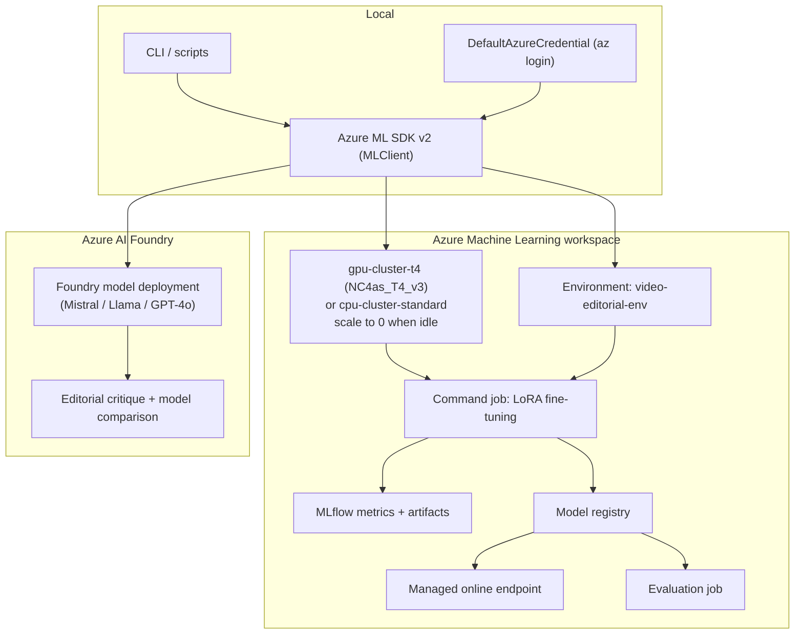
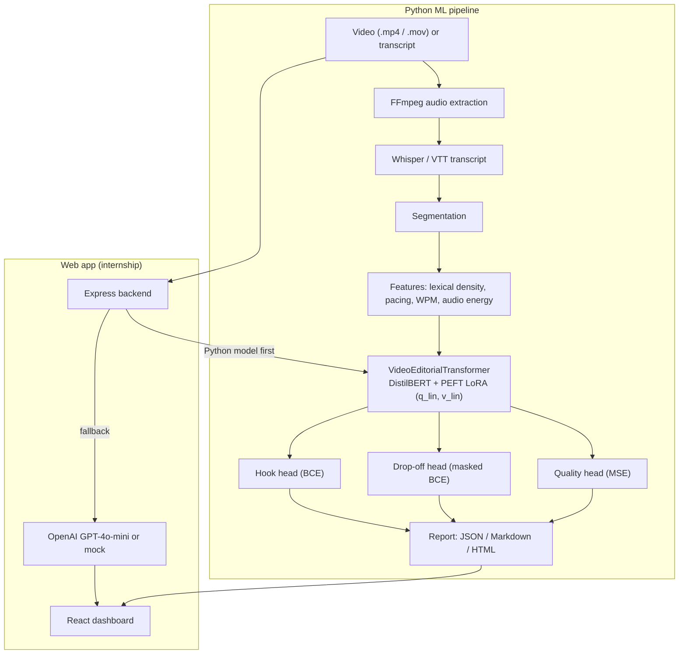

# Video Editorial Intelligence

<p align="center">
  
  
  
  
  
  
  
</p>

> Predict **hooks**, **viewer drop-off risk** and **editorial quality** for short-form and long-form video, from a model trained on **55,587 real samples** with *measured* audience-retention curves (TikTok, YouTube, Bilibili). Open-source data adapters, a DistilBERT + LoRA multi-head model, honest per-source evaluation, and ready-to-run **Azure Machine Learning** and **Azure AI Foundry** workflows.

Built as part of the **Microsoft Türkiye AI Innovators Internship Program 2026**, with the Python ML pipeline, real-data layer and Azure tooling added after the internship (see [Development History](#development-history)).

---

## Table of Contents

1. [Status: what is trained vs. ready to run](#status-what-is-trained-vs-ready-to-run)
2. [Results](#results)
3. [Azure AI Foundry + Azure Machine Learning](#azure-ai-foundry--azure-machine-learning)
4. [Architecture](#architecture)
5. [Real data](#real-data)
6. [Quick Start](#quick-start)
7. [Train it yourself (CPU, free Kaggle GPU, or Azure ML)](#train-it-yourself)
8. [Project Structure](#project-structure)
9. [Limitations](#limitations)
10. [Roadmap](#roadmap)
11. [Development History](#development-history)
12. [Contributing](#contributing)
13. [License](#license)

---

## Status: what is trained vs. ready to run

### Trained (real runs, logs and metrics exist)

| Run | Hardware | Data | Training time | Status |
|---|---|---|---|---|
| **v4: LoRA, current model** | **Kaggle Tesla T4 GPU (free)** | **55,587 real samples** | 1,839 s (31 min), 5 epochs | ✅ trained + evaluated on 7,352 held-out samples |
| Frozen-encoder ablation | Kaggle Tesla T4 GPU | 56,456 real samples | 958 s, 5 epochs | ✅ trained + evaluated (heads only; kept as a comparison) |
| v2: LoRA | CPU (8 cores) | 18,150 real samples | 6,790 s, 4 epochs | ✅ trained + evaluated (previous reference) |
| v3: masked drop-off loss | CPU | 18,150 real samples | 2,441 s, 3 epochs | ✅ trained + evaluated (ablation) |

Checkpoints are not committed: they were trained on research-use-only data. Rebuild them with the commands in [Train it yourself](#train-it-yourself).

### Ready to run (code + configs verified, not yet executed against a live cloud account)

| Component | What it does | Verified how |
|---|---|---|
| **Azure ML workspace bootstrap** (`azure/ml/setup_workspace.py`) | Workspace, scale-to-zero T4 GPU cluster, CPU fallback cluster, environment | dry-run + unit tests |
| **Azure ML training / evaluation jobs** (`azure/ml/submit_training.py`, `submit_evaluation.py`) | SDK v2 command jobs on T4 GPU (or CPU), MLflow metrics, log streaming | dry-run + unit tests |
| **Azure ML model registry + managed online endpoint** (`register_model.py`, `deploy_model.py`) | Register checkpoint, deploy, **delete** endpoint | dry-run + unit tests |
| **Azure AI Foundry** (`azure/foundry/`) | Editorial critique and model comparison with Foundry-hosted models (Mistral / Llama / GPT-4o) via `azure-ai-inference` | offline simulation mode (responses flagged `simulated: true`) |

### Runs locally today

| Component | Command |
|---|---|
| Video / transcript analysis (FFmpeg → segments → model → JSON/MD/HTML report) | `python -m src.cli analyze --video examples/sample_video.mp4` |
| Streamlit demo | `python -m src.cli demo` |
| React + Node web app (OpenAI or mock mode, Python model bridge) | `npm run install:all && npm run dev` |
| Test suites | `pytest tests` (43 tests), `npm test --prefix server` (3 tests); CI runs both plus the frontend build |

---

## Results

**v4 model:** DistilBERT + PEFT LoRA (446,211 trainable / 66,809,091 parameters, 0.67%), trained on a free **Kaggle Tesla T4 GPU** on **55,587 real samples**. Group-aware split (no creator, video or identical text crosses train/test): train 39,310, val 8,925, **test 7,352**.

Per-source metrics on the held-out test split (the honest view; pooled numbers are inflated because the model can tell sources apart):

| Head | Metric | TTCC ads (measured retention) | vRetention (measured retention) | TikTok hooks (engagement) |
|---|---|---:|---:|---:|
| Hook | ROC-AUC | **0.68** | n/a (95% positive) | 0.51 |
| Hook | F1 @0.5 | 0.31 | 0.96 | 0.87 |
| Drop-off | ROC-AUC | **0.67** | 0.58 | n/a (no curves) |
| Drop-off | PR-AUC | **0.84** | 0.85 | n/a |
| Quality | RMSE (1–10) | **0.79** | 1.87 | 1.59 |
| Quality | Pearson r | **0.21** | 0.19 | 0.06 |

| Inference | Latency |
|---|---|
| Tesla T4 GPU | 4.4 ms / segment (228 segments/s) |
| CPU (8 cores) | ~65 ms / segment |

**Scaling 18,150 → 55,587 samples (TTCC ads, LoRA both times):** hook ROC-AUC 0.66 → 0.68, drop-off ROC-AUC 0.64 → 0.67, PR-AUC 0.81 → 0.84, quality r 0.08 → 0.21, quality RMSE 0.99 → 0.79. Hook F1 at the fixed 0.5 threshold fell 0.38 → 0.31 (threshold not tuned).

What this shows: a real but modest signal for drop-off, hook and quality on TikTok ads with measured retention curves, which improves with more data. Predicting engagement-outlier hooks from caption text alone is near chance. These are baseline numbers to beat, not production accuracy. Full tables, ablations and caveats: [docs/EVALUATION.md](docs/EVALUATION.md).

---

## Azure AI Foundry + Azure Machine Learning

Bring your own Azure subscription; every command is **dry-run by default** and only creates resources or costs money with `--create`, `--submit`, `--register` or `--deploy`. None of these live commands have been executed from this repo yet.



### Azure Machine Learning: train on a T4 GPU (~$1)

```bash
az login
az group create -n rg-video-editorial -l eastus
export AZURE_SUBSCRIPTION_ID="<your-subscription-id>"
export AZURE_RESOURCE_GROUP="rg-video-editorial"
export AZURE_WORKSPACE_NAME="aml-video-editorial"

# 1. Workspace + scale-to-zero T4 GPU cluster + CPU fallback cluster + environment
python -m azure.ml.setup_workspace --create

# 2. Build the real corpus (see Real data), then train on GPU and stream logs
python -m azure.ml.submit_training --dataset-path data/real/combined.jsonl \
    --epochs 5 --batch-size 64 --submit --stream
#    No GPU quota yet? add: --compute cpu-cluster-standard

# 3. Evaluate, register, deploy, and DELETE the endpoint after the demo
python -m azure.ml.submit_evaluation --submit --checkpoint-asset azureml:video-editorial-transformer:1
python -m azure.ml.register_model --checkpoint-dir checkpoints/editorial_model_kaggle --register
python -m azure.ml.deploy_model --deploy
python -m azure.ml.deploy_model --delete   # endpoints bill hourly even when idle
```

Drop the action flag (`--create`, `--submit`, `--register`, `--deploy`) from any command to preview the exact spec without touching Azure.

| Resource | Size | Approx. list price* | Idle cost |
|---|---|---|---|
| `gpu-cluster-t4` | Standard_NC4as_T4_v3 (1× T4) | ~$0.53/h → ~$0.25–1 per run | $0 (scales to 0) |
| `cpu-cluster-standard` | Standard_DS3_v2, low-priority | ~$0.05–0.2/h | $0 (scales to 0) |
| Online endpoint | Standard_DS3_v2 | ~$0.3/h | **bills while it exists**, use `--delete` |

\*Estimates, not verified quotes; check the [Azure pricing calculator](https://azure.microsoft.com/pricing/calculator/) for your region. New/free subscriptions often start with 0 GPU quota: request "Standard NCASv3_T4 Family" (4 vCPUs) under Quotas → Machine Learning. Azure budgets alert by default; they do not stop spending.

Alternative to env vars: `cp azure/ml/config.json.example azure/ml/config.json`. Details: [docs/AZURE_MACHINE_LEARNING.md](docs/AZURE_MACHINE_LEARNING.md), [azure/ml/README.md](azure/ml/README.md).

### Azure AI Foundry: editorial critique with hosted models

```bash
# Configure a Foundry model deployment (endpoint + key), see docs/AZURE_AI_FOUNDRY.md
python -m azure.foundry.inference --transcript examples/sample_transcript.json
python -m azure.foundry.inference --model mistral-large-2407
python -m azure.foundry.evaluation --models mistral-large-2407 Meta-Llama-3.1-70B-Instruct
```

Without a configured endpoint the client runs in **offline simulation mode** and flags every response `simulated: true`, so tests and demos run at zero cost. Details: [docs/AZURE_AI_FOUNDRY.md](docs/AZURE_AI_FOUNDRY.md).

---

## Architecture



| Component | File | Role |
|---|---|---|
| `VideoEditorialTransformer` | `src/models/multi_head_transformer.py` | DistilBERT backbone + 3 prediction heads |
| LoRA injection / checkpointing | `src/models/peft_adapter.py` | PEFT adapters, save/load |
| Training | `src/train.py` | Group-aware split, masked drop-off loss, CPU/CUDA/MPS |
| Evaluation | `src/evaluate.py` | ROC-AUC, PR-AUC, Brier, RMSE, Pearson r, per-source breakdown, latency |
| Real-data adapters | `src/data/real/` | TTCC, vRetention, YouTube captions, TikTok hooks → one JSONL schema |
| Video pipeline | `src/pipeline/video_pipeline.py` | FFmpeg → transcript → segments → report |
| CLI | `src/cli.py` | `analyze`, `train`, `evaluate`, `demo` |
| Kaggle runner | `kaggle/` | Free T4 GPU collection + training + evaluation |
| Azure ML | `azure/ml/` | Workspace, jobs, registry, endpoint |
| Azure AI Foundry | `azure/foundry/` | Hosted-model critique + comparison |
| Web app | `server/`, `client/` | Express API + React dashboard |

LoRA configuration: r = 8, alpha = 16, dropout 0.05, target modules `q_lin`, `v_lin`, learning rate 2e-4.

---

## Real data

Viewer-retention data is normally private to each channel owner. This repo turns public research datasets into labeled training examples with one schema and provenance on every row:

| Source | Platform | Used in v4 | Available | Labels |
|---|---|---:|---:|---|
| TikTok Creative Center (`liangyuch/ttcc-v0_2_0`) | TikTok ads | 16,941 | 61,789 | **measured** 1 Hz retention curve |
| vRetention (`flowtele/vRetention`) | YouTube / Bilibili | 2,000 | see DATASETS.md | **measured** retention curve |
| vRetention + yt-dlp captions | YouTube | 150 | – | measured curve + real transcript |
| TikTok hooks (`benxh/tiktok-hooks-finetune`) | TikTok | 36,496 (all English) | 46,605 | engagement-derived (views ≥ 2× account median) |
| **Total** | | **55,587** | | |

Labels: hook = ≥ 20% of viewers retained at 3 s; drop-off risk = largest single-second relative audience loss; quality = retention-curve AUC mapped to 1–10. TikTok-hooks rows have no curve, so they are masked out of the drop-off loss and reported as `n/a`, never as true negatives.

TTCC and vRetention are **research-use only**: the repo ships adapters, not data. Sources, licenses and commands: [docs/DATASETS.md](docs/DATASETS.md).

---

## Quick Start

```bash
git clone https://github.com/Nabilhassan12345/video-editorial-intelligence.git
cd video-editorial-intelligence
python3 -m venv .venv && source .venv/bin/activate     # Windows: .venv\Scripts\activate
pip install -e ".[dev]"                                # Python 3.10+; FFmpeg on PATH for video input

pytest tests -q                                        # 43 tests
python -m src.cli analyze --video examples/sample_video.mp4 --output-dir outputs/reports
python -m src.cli demo                                 # Streamlit UI at http://localhost:8501

npm run install:all && npm run dev                     # optional React + Node web app
```

FFmpeg: `brew install ffmpeg` (macOS), `sudo apt-get install -y ffmpeg` (Ubuntu), `choco install ffmpeg` (Windows).

---

## Train it yourself

```bash
# 1. Collect real data (see docs/DATASETS.md for every source and option)
python -m src.data.real.collect --source tiktok-hooks --limit 46605 --lang en --out data/real/hooks.jsonl
python -m src.data.real.collect --source ttcc --limit 5000 --out data/real/ttcc.jsonl
python -m src.data.real.collect --source vretention --limit 2000 --out data/real/vretention.jsonl
cat data/real/*.jsonl > data/real/combined.jsonl

# 2a. Local (CPU works; ~2 h for 18k samples)
python -m src.train --dataset-path data/real/combined.jsonl --epochs 4 --batch-size 32 \
    --output-dir checkpoints/editorial_model

# 2b. Free Kaggle T4 GPU (private kernel + private dataset): collects, trains and evaluates
python kaggle/launch.py          # see kaggle/README.md

# 2c. Azure ML T4 GPU: see the Azure section above

# 3. Evaluate on the same group-aware split
python -m src.evaluate --checkpoint-dir checkpoints/editorial_model \
    --dataset-path data/real/combined.jsonl --output-dir reports/eval
```

`python -m src.train --dry-run` checks the training loop in seconds; without `--dataset-path` training falls back to a 70-sample synthetic sanity set.

---

## Project Structure

```text
video-editorial-intelligence/
├── src/
│   ├── cli.py                    # analyze / train / evaluate / demo
│   ├── train.py, evaluate.py     # training + evaluation
│   ├── models/                   # multi_head_transformer.py, peft_adapter.py, config.py
│   ├── data/                     # dataset.py, feature_engineering.py, segmenter.py
│   │   └── real/                 # ttcc.py, vretention.py, youtube.py, tiktok_hooks.py, labels.py, collect.py
│   ├── audio/extractor.py        # FFmpeg audio features
│   └── pipeline/                 # video_pipeline.py, report_generator.py
├── kaggle/                       # free-GPU runner: run_kaggle.py, launch.py
├── azure/
│   ├── ml/                       # setup_workspace, submit_training/evaluation, register, deploy, jobs/, environments/, scoring/
│   └── foundry/                  # client, inference, evaluation, prompts/, configs/
├── demo/app.py                   # Streamlit dashboard
├── server/, client/              # Express API + React/Vite dashboard
├── tests/                        # 43 pytest tests
├── examples/                     # sample video, transcript, reports
└── docs/                         # ARCHITECTURE, DATASETS, DATA_PIPELINE, EVALUATION, FINE_TUNING,
                                  # AZURE_MACHINE_LEARNING, AZURE_AI_FOUNDRY, DEPLOYMENT, REPRODUCIBILITY, PROJECT_OVERVIEW
```

---

## Limitations

1. **Modest accuracy.** Within-source ROC-AUC is 0.58–0.68; this is a baseline, not a production model.
2. **Mostly text-driven.** Most TTCC ads are music-only (no speech), so the model leans on captions and simple audio features; visual features are not used yet.
3. **Partial TTCC coverage.** v4 used 16,941 of 61,789 TTCC ads, and the number collected varies slightly between runs.
4. **Small YouTube transcript subset.** Only 150 videos have both a real transcript and a measured curve (18 in the test split), so those numbers are noise.
5. **Engagement ≠ retention.** TikTok-hooks labels come from view counts, not viewer retention.
6. **No threshold calibration.** Hook F1 uses a fixed 0.5 threshold.
7. **Cloud paths not exercised live.** Azure ML and Azure AI Foundry are verified in dry-run / simulation only.
8. **Research-use data.** Models trained on TTCC/vRetention inherit their non-commercial terms.

---

## Roadmap

- [x] Real retention-labeled data adapters (TTCC, vRetention, YouTube captions, TikTok hooks)
- [x] GPU training on 55k+ real samples (free Kaggle T4)
- [x] Azure ML + Azure AI Foundry workflows (dry-run verified)
- [ ] Live Azure ML training job + Foundry endpoint run
- [ ] Full 61,789-ad TTCC corpus
- [ ] Threshold calibration on the validation split
- [ ] Visual features (frame embeddings) and per-segment labels
- [ ] EnTube (YouTube engagement) adapter
- [ ] FastAPI inference server; UGC hook-testing workflow for creators and agencies
- [ ] YouTube Analytics API connector for creators' own retention data

---

## Development History

### Microsoft Türkiye AI Innovators Internship, Summer 2026

The initial system was built during the **Microsoft Türkiye AI Innovators Internship Program 2026** (commits from July 27, 2026):

- Node.js / Express backend (`server/`) with transcript segmentation and a structured JSON schema
- OpenAI GPT-4o-mini editorial analysis (with mock mode)
- React + Tailwind dashboard with history and report views

### After the internship, November 2026

- Python ML pipeline (`src/`): FFmpeg features, segmentation, DistilBERT + LoRA multi-head model, reports
- Real-data layer (`src/data/real/`) and group-aware, leakage-checked evaluation
- GPU training on a free Kaggle T4 (`kaggle/`)
- Azure Machine Learning (`azure/ml/`) and Azure AI Foundry (`azure/foundry/`) tooling
- Streamlit demo, Node ↔ Python bridge, CI, and documentation

---

## Contributing

1. Fork and create a branch: `git checkout -b feature/my-feature`
2. `pip install -e ".[dev]"`
3. `pytest tests -q` and `npm test --prefix server`
4. Open a pull request against `master`

Good first contributions: new platform adapters in `src/data/real/`, threshold calibration, visual features.

---

## License

Code is licensed under the **Apache License 2.0**; see [LICENSE](LICENSE). The datasets used for training have their own licenses (TTCC and vRetention are research-use only) and are not covered by this license or redistributed here; see [docs/DATASETS.md](docs/DATASETS.md).
