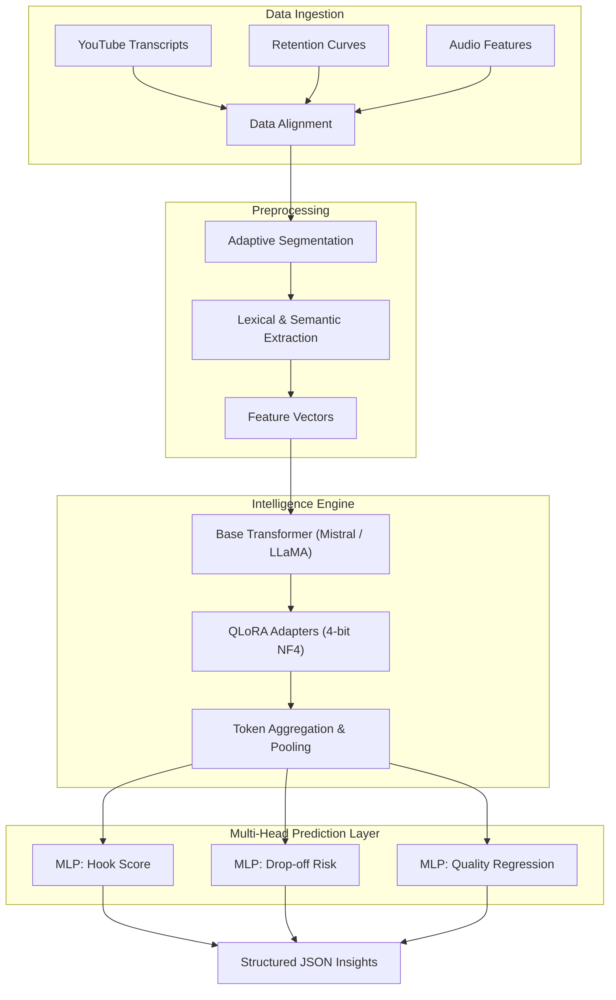

# Video Editorial Intelligence

A data-driven editorial intelligence system that transforms how video content is created and optimized.

## 🧠 Project Overview

**Video Editorial Intelligence** is a production-grade machine learning pipeline designed to systematically analyze video transcripts and audio-derived features. The system operates as an applied ML and NLP intelligence layer for content creation, predicting viewer behavior and surfacing actionable editorial insights. 

By modeling the complex relationship between spoken narrative, pacing, and viewer retention, the system predicts:
- **Viewer Engagement & Retention:** Forecasting normalized retention curves based on temporal pacing and semantic density.
- **Drop-off Risks:** Identifying specific temporal windows where viewer decay probability spikes.
- **Hook Effectiveness:** Classifying and ranking the highest-converting attention vectors in the introduction.
- **Editorial Quality:** Outputting a holistic, regressed quality score indicating structural pacing and narrative flow.

## 🏗️ System Architecture

Our architecture is built on a robust, multi-stage data processing and inference pipeline:



### 1. Data Ingestion
The system ingests multimodal signals to construct a comprehensive representation of the video content:
- **Time-Aligned Transcripts:** High-fidelity VTT/SRT data mapped precisely to video timestamps.
- **Retention Time-Series:** Normalized audience retention curves directly extracted from historical analytics.
- **Audio Features (Optional but Supported):** Integration of phonetic and acoustic signals such as RMS energy, speaking rate (WPM), and silence gap duration.

### 2. Preprocessing & Feature Engineering
Raw text and audio signals are transformed into dense feature vectors suitable for sequence modeling:
- **Adaptive Segmentation:** Transcripts are chunked into adaptive temporal windows (e.g., 5–15 seconds) based on natural sentence boundaries and pause lengths.
- **Lexical & Semantic Extraction:** Computing lexical density, syntactic complexity, and attention-based keyword salience.
- **Temporal Alignment:** Structuring data so that every text/audio segment vector perfectly aligns with the ground-truth derivative of the retention curve.

### 3. Model Architecture
The core intelligence engine utilizes a hybrid transformer architecture optimized for edge and scalable cloud deployment.

#### Text Encoder
- **Base Architecture:** Small-parameter transformer models (e.g., Mistral 7B or LLaMA 3 8B variants) act as the foundational semantic encoders.
- **Embedding Aggregation:** Token-level embeddings are mean-pooled and temporally aggregated to represent distinct video segments.

#### Fine-Tuning Methodology
- **QLoRA (Quantized Low-Rank Adaptation):** The base models are frozen and quantized to 4-bit precision (NF4) for maximum GPU memory efficiency during training and inference.
- **Adapter Injection:** Low-rank adapters are injected directly into the attention mechanism (Q, K, V projections) to learn the specific domain distribution of video pacing and retention without catastrophic forgetting.

#### Multi-Head Prediction Layer
The aggregated sequence embeddings are passed through a custom Multi-Layer Perceptron (MLP) head architecture yielding distinct outputs:
1. **Hook Score:** A classification/ranking output identifying the most potent initial segments.
2. **Drop-off Probability:** A per-segment sigmoid output predicting the likelihood of significant viewer churn.
3. **Quality Score:** A continuous regression output (1–10) evaluating overall structural integrity.

### 4. Training Strategy
The model is trained via rigorous supervised learning over large-scale, proprietary retention data.
- **Label Generation:**
  - **Hooks:** Positive labels generated from segments corresponding to early-stage retention peaks or plateaus.
  - **Drop-offs:** Labeled dynamically by calculating the first derivative of the retention curve and thresholding sharp negative gradients.
- **Loss Functions:**
  - *Drop-off Detection:* Binary Cross-Entropy (BCE) Loss.
  - *Quality Scoring:* Mean Squared Error (MSE) Loss.
  - *Hook Detection:* Pairwise Ranking Loss to optimize the relative strength of intro segments.

### 5. Inference Pipeline
1. Ingest raw transcript and segment via the preprocessing engine.
2. Tokenize and pass through the QLoRA-adapted transformer.
3. Aggregate segment predictions across the multi-head layers.
4. Format predictions into structured, deterministic insights.

## 🤖 Model Infrastructure & Stack

- **Base Models:** Mistral 7B / LLaMA 3 (Small variants optimized for inference speed)
- **Deep Learning Framework:** PyTorch, Hugging Face `transformers`
- **Parameter-Efficient Tuning:** Hugging Face `peft` and `bitsandbytes` (4-bit quantization)
- **Backend Routing:** Node.js / FastAPI for scalable, concurrent inference processing
- **Frontend Dashboard:** React + Tailwind CSS for real-time editorial feedback visualization

## 📊 Dataset Design

The foundational model is trained on a highly curated dataset designed to capture the nuance of successful video pacing:
- **Scale:** ~50,000 highly-performant videos across diverse niches.
- **Data Sources:** Mined YouTube transcripts mapped synchronously to YouTube Analytics retention curve exports.
- **Normalization:** Retention curves are normalized to account for variable video lengths, transforming absolute duration into relative progression percentiles.

## 📈 Evaluation Metrics

The system's performance is continuously evaluated against rigorous ML baselines:
- **Drop-off Prediction:** AUC-ROC (Area Under the Receiver Operating Characteristic Curve) ensures high precision in identifying critical churn moments.
- **Hook Detection:** F1-Score balancing precision and recall for early-video engagement classification.
- **Quality Scoring:** RMSE (Root Mean Square Error) against human-annotated and retention-derived baseline quality scores.
- **Retention Correlation:** Pearson correlation coefficient between the predicted retention decay curve and the ground-truth analytics.

## 🚀 Output Schema

The inference API strictly adheres to a structured JSON schema, ensuring seamless integration into automated editing workflows and dashboards:

```json
{
  "hook": "[00:12] The exact high-retention text segment.",
  "drop_off_risks": [
    {
      "timestamp": "[01:45]",
      "reason": "Lexical density spike and absence of keyword salience indicating viewer fatigue."
    }
  ],
  "quality_score": 8.5,
  "improvements": [
    "Increase temporal pacing between [01:45] and [02:10]",
    "Re-structure the hook segment to front-load the primary narrative vector."
  ]
}
```

## 🔮 Future Work

Our roadmap focuses on expanding the model's sensory inputs and feedback loops:
- **Multimodal Learning:** Integrating visual frame processing (CNN/ViT) alongside audio and text for a complete multimodal understanding of engagement.
- **Real-Time Editing Integration:** Deploying lightweight inference models directly as NLE (Non-Linear Editor) plugins for real-time editorial feedback.
- **RLHF (Reinforcement Learning from Human Feedback):** Training a reward model based on iterative A/B testing of video edits to continually optimize the policy.
- **Creator Personalization:** Dynamic LoRA adapter swapping to match the specific pacing and stylistic fingerprint of individual creators.
