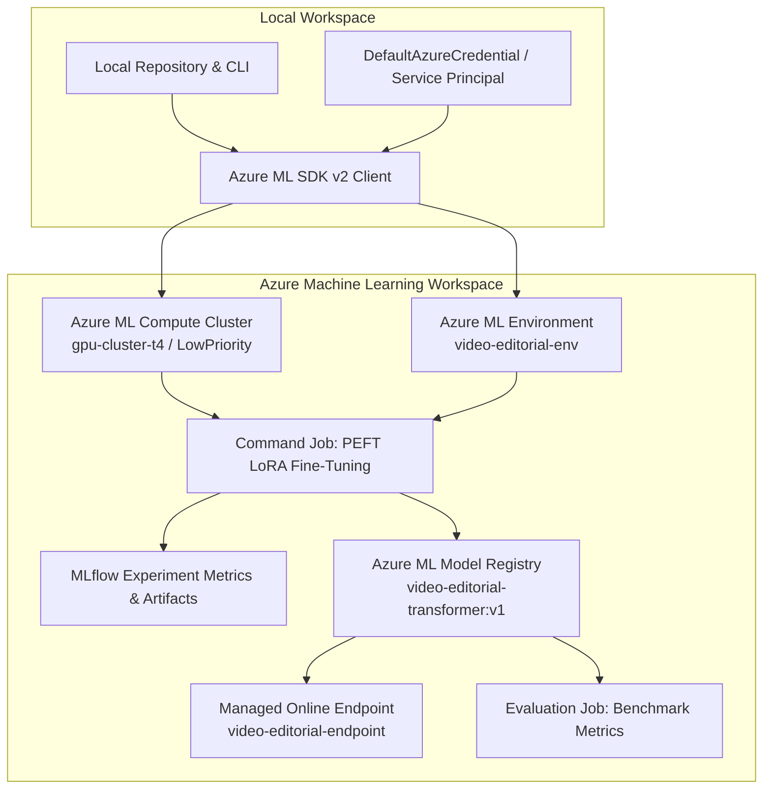

# ☁️ Azure Machine Learning (SDK v2) Integration

This directory contains the production-grade **Microsoft Azure Machine Learning (Azure ML SDK v2)** workflow for Video Editorial Intelligence.

The integration provides reproducible cloud training, experiment tracking via MLflow, scalable model evaluation, automated model registration, and managed online endpoint deployment.

---

## 🏗️ Architecture Overview



---

## 📁 Directory Structure

```text
azure/ml/
├── README.md                  # This architectural and operational guide
├── config.json.example        # Workspace configuration template
├── environments/
│   ├── video-editorial-env.yml# Conda environment specification
│   └── Dockerfile             # Production container with FFmpeg + CUDA
├── jobs/
│   ├── compute_config.yaml    # Compute cluster definitions & cost policies
│   ├── training_job.yaml      # SDK v2 Command Job specification (training)
│   └── evaluation_job.yaml    # SDK v2 Command Job specification (evaluation)
├── components/
│   └── pipeline_components.py # Reusable modular pipeline components
├── submit_training.py         # Submits fine-tuning job via MLClient
├── submit_evaluation.py       # Submits evaluation job via MLClient
├── register_model.py          # Registers trained model in Model Registry
└── deploy_model.py            # Deploys Managed Online Endpoint
```

---

## ⚙️ Configuration & Prerequisites

### 1. Environment Variables
Configure your Azure credentials in `.env` or set them in your terminal session:

```bash
export AZURE_SUBSCRIPTION_ID="<your-subscription-id>"
export AZURE_RESOURCE_GROUP="<your-resource-group>"
export AZURE_WORKSPACE_NAME="<your-aml-workspace>"
export AZURE_LOCATION="eastus"
```

Alternatively, copy `azure/ml/config.json.example` to `azure/ml/config.json`:

```bash
cp azure/ml/config.json.example azure/ml/config.json
# Edit azure/ml/config.json with your Azure ML Workspace details
```

### 2. Authentication
The workflow utilizes `DefaultAzureCredential` from `azure-identity`. This automatically authenticates using:
1. Azure CLI (`az login`)
2. Environment variables (`AZURE_CLIENT_ID`, `AZURE_CLIENT_SECRET`, `AZURE_TENANT_ID`)
3. Managed Identity (when executing within Azure)

---

## 🚀 Execution Commands

All scripts include a **safety dry-run mode** by default. Running without the live execution flag previews the Azure ML job specification locally without incurring cloud charges.

### 1. Submit Fine-Tuning Job
Preview the SDK v2 job specification:
```bash
python -m azure.ml.submit_training
```

Submit live to your Azure ML compute cluster:
```bash
python -m azure.ml.submit_training --submit --compute gpu-cluster-t4 --epochs 3
```

### 2. Submit Model Evaluation Job
Preview evaluation job specification:
```bash
python -m azure.ml.submit_evaluation
```

Submit live evaluation job:
```bash
python -m azure.ml.submit_evaluation --submit --checkpoint-asset azureml:video-editorial-transformer:1
```

### 3. Register Model Asset
Preview model asset tags and registration payload:
```bash
python -m azure.ml.register_model --checkpoint-dir checkpoints/editorial_model
```

Register model into the Azure ML Model Registry:
```bash
python -m azure.ml.register_model --checkpoint-dir checkpoints/editorial_model --register
```

### 4. Deploy to Managed Online Endpoint
Preview deployment configuration:
```bash
python -m azure.ml.deploy_model --endpoint video-editorial-endpoint
```

Deploy live to Azure ML Managed Online Endpoint:
```bash
python -m azure.ml.deploy_model --endpoint video-editorial-endpoint --deploy
```

---

## 💡 Cost-Conscious Infrastructure Guidelines

1. **Automatic Scale-Down (`min_instances = 0`):** Both compute cluster templates (`compute_config.yaml`) configure `min_instances = 0`. Compute nodes automatically deprovision after idle timeouts (120–180 seconds).
2. **Low-Priority / Spot VM Tiers:** For evaluation and preprocessing, `Standard_DS3_v2` with `tier: LowPriority` provides up to an 80% discount over standard on-demand pricing.
3. **Explicit Commands Only:** Cloud operations are never triggered automatically or as side effects.

