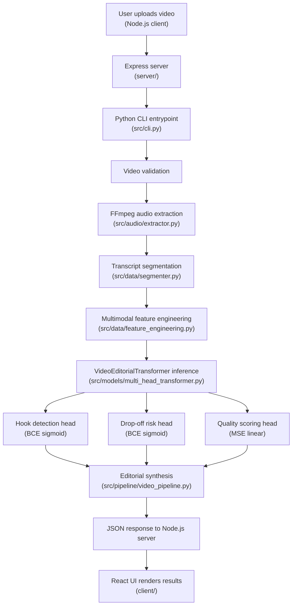

# System Architecture

## Overview

Video Editorial Intelligence is a full-stack application that combines a **Node.js web UI** with a **Python ML pipeline** to provide AI-powered editorial analysis of video content. Users upload a video through the browser; the server extracts audio, transcribes and segments the speech, runs multimodal feature engineering, and passes the segments through a fine-tuned multi-head transformer to produce grounded editorial intelligence (hook detection, drop-off risk, quality scoring).

---

## End-to-End Pipeline

---

## VideoEditorialTransformer

`VideoEditorialTransformer` ([`src/models/multi_head_transformer.py`](../src/models/multi_head_transformer.py)) is the core ML model.

### Architecture

- **Backbone:** `distilbert-base-uncased` (66 M parameters). DistilBERT was chosen for its balance of representational power and inference speed on CPU.
- **PEFT LoRA adapters:** Low-rank adapters are injected into the `q_lin` and `v_lin` projection matrices of every DistilBERT attention layer (DistilBERT-specific naming; not `query`/`value` as in BERT-base). This keeps 99.33 % of weights frozen during fine-tuning.
- **Pooling:** Mean pooling over all non-padding token embeddings produces a fixed-size `[batch, 768]` sentence representation.
- **Multimodal fusion:** An 8-dimensional acoustic feature vector (pitch, energy, speech rate, etc.) is projected via a small MLP and concatenated with the pooled text embedding to form a 776-dimensional fused vector.
- **Prediction heads** (each is a two-layer MLP with ReLU + dropout):
  | Head | Output activation | Loss | Purpose |
  |---|---|---|---|
  | Hook detection | Sigmoid | Binary Cross-Entropy | Predict whether a segment is an engaging hook |
  | Drop-off risk | Sigmoid | Binary Cross-Entropy | Predict viewer drop-off probability |
  | Quality scoring | Linear (no activation) | Mean Squared Error | Predict a continuous quality score (0–10) |

---

## Component Table

| Component | File | Role |
|---|---|---|
| **EditorialModelConfig** | [`src/models/config.py`](../src/models/config.py) | Dataclass holding all model hyperparameters (LoRA rank, target modules, etc.) |
| **TrainingConfig** | [`src/models/config.py`](../src/models/config.py) | Dataclass holding all training hyperparameters (epochs, lr, batch size, seed) |
| **VideoEditorialTransformer** | [`src/models/multi_head_transformer.py`](../src/models/multi_head_transformer.py) | DistilBERT + mean pool + 3 task-specific heads |
| **PEFT adapter utilities** | [`src/models/peft_adapter.py`](../src/models/peft_adapter.py) | Inject LoRA adapters, save/load fine-tuned checkpoints |
| **VideoEditorialDataset** | [`src/data/dataset.py`](../src/data/dataset.py) | PyTorch Dataset wrapping tokenised segments + feature vectors |
| **TranscriptSegmenter** | [`src/data/segmenter.py`](../src/data/segmenter.py) | Splits transcript into timed segments |
| **FeatureEngineer** | [`src/data/feature_engineering.py`](../src/data/feature_engineering.py) | Builds multimodal feature vectors (acoustic + lexical) per segment |
| **AudioExtractor** | [`src/audio/extractor.py`](../src/audio/extractor.py) | FFmpeg wrapper; extracts audio from video and computes acoustic features |
| **VideoPipeline** | [`src/pipeline/video_pipeline.py`](../src/pipeline/video_pipeline.py) | Orchestrates all pipeline stages; returns structured JSON editorial report |
| **Training entrypoint** | [`src/train.py`](../src/train.py) | PEFT LoRA fine-tuning loop with multi-task composite loss |
| **Evaluation suite** | [`src/evaluate.py`](../src/evaluate.py) | Benchmarks baseline vs. fine-tuned model across all metrics |
| **CLI** | [`src/cli.py`](../src/cli.py) | Command-line interface for video analysis |
| **Express server** | [`server/`](../server/) | Node.js/Express API; invokes Python CLI, streams results to React client |
| **React client** | [`client/`](../client/) | Browser UI for video upload and result visualisation |
| **Azure ML integration** | [`azure/ml/`](../azure/ml/) | Cloud training/evaluation jobs via Azure ML SDK v2 |
| **Azure AI Foundry integration** | [`azure/foundry/`](../azure/foundry/) | Serverless LLM inference for high-level editorial critique |
