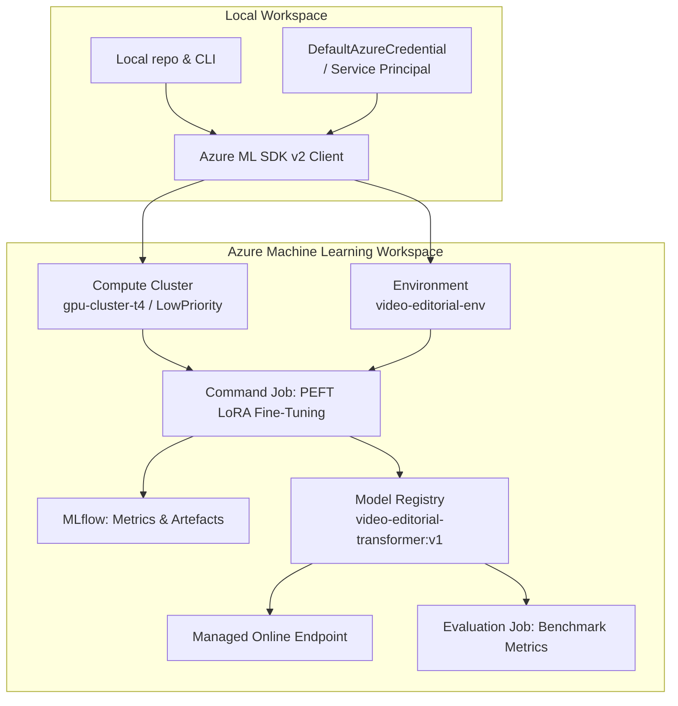

# Azure Machine Learning Integration

> For detailed operational instructions, see [`azure/ml/README.md`](../azure/ml/README.md).

---

## Overview

The `azure/ml/` directory provides a production-grade **Azure ML SDK v2** workflow for:

- Reproducible cloud training of the PEFT LoRA fine-tuned model on GPU compute clusters
- Experiment tracking via **MLflow** (metrics, artefacts, parameters)
- Scalable model evaluation jobs
- Automated **model registration** in the Azure ML Model Registry
- Optional **managed online endpoint** deployment for real-time inference

---

## Architecture



---

## Workspace Setup

1. **Copy and populate the workspace config:**

   ```bash
   cp azure/ml/config.json.example azure/ml/config.json
   # Edit azure/ml/config.json with your subscription_id, resource_group, workspace_name
   ```

2. **Authenticate:**

   ```bash
   az login
   # or set AZURE_CLIENT_ID / AZURE_CLIENT_SECRET / AZURE_TENANT_ID for a service principal
   ```

3. **Install Azure ML dependencies:**

   ```bash
   pip install azure-ai-ml azure-identity
   ```

---

## Key Files

| File | Purpose |
|---|---|
| [`azure/ml/config.json.example`](../azure/ml/config.json.example) | Workspace configuration template |
| [`azure/ml/training_job.yaml`](../azure/ml/training_job.yaml) | Azure ML Command Job spec for PEFT LoRA training |
| [`azure/ml/evaluation_job.yaml`](../azure/ml/evaluation_job.yaml) | Azure ML Command Job spec for benchmark evaluation |
| [`azure/ml/compute_config.yaml`](../azure/ml/compute_config.yaml) | Compute cluster definition (VM size, min/max nodes) |
| [`azure/ml/README.md`](../azure/ml/README.md) | Full operational guide |

---

## Job Submission

### Dry-run (default — validates config locally, no cloud resources used)

```bash
cd video-editorial-intelligence
.venv/bin/python azure/ml/submit_job.py
```

### Submit live training job to Azure ML

```bash
.venv/bin/python azure/ml/submit_job.py --submit
```

### Submit evaluation job

```bash
.venv/bin/python azure/ml/submit_job.py --job evaluation --submit
```

---

## Model Registration

After a successful training job, the model is automatically registered:

```bash
.venv/bin/python azure/ml/register_model.py --run-id <mlflow_run_id>
```

Or register manually from a local checkpoint:

```bash
.venv/bin/python azure/ml/register_model.py --local-path checkpoints/editorial_model/best_model.pt
```

---

## Deployment (Optional)

Deploy the registered model to a managed online endpoint:

```bash
.venv/bin/python azure/ml/deploy_endpoint.py --model-name video-editorial-transformer --model-version 1
```

---

## Azure AI Foundry

For serverless LLM inference (editorial critique, transcript restructuring) using frontier models (Mistral Large, LLaMA 3.1, GPT-4o), see [`azure/foundry/README.md`](../azure/foundry/README.md). This is distinct from Azure ML: Foundry uses pay-per-token serverless endpoints rather than dedicated compute clusters.
